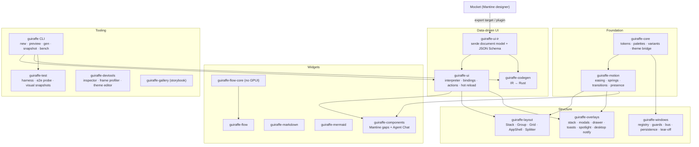

# GUIraffe 🦒 — Design

> Make rich, fluid, beautiful desktop apps in Rust a breeze — and keep them fast.
>
> **North star:** building a GUIraffe app should feel as convenient and flexible as building a
> React app. Someone choosing between Electron + React and GUIraffe should find GUIraffe the better
> choice: the same productivity (components, state, routing, forms, data fetching, hot reload,
> devtools, design-tool import), with native speed, a fraction of the memory, and one language.
> The parity checklist (§13) tracks this.

This is the master design. Per-crate details live in `spec/NN-*.md`; sequencing, owners and
status live in `plans/ROADMAP.md` and `TODO.md`; review findings in `reviews/`.

## 1. Goals and non-goals

**Goals**
1. A *toolkit*, not just widgets: theming, layout, motion, multi-window, overlays, data-driven
   UI, design-tool import, dev tools and test tools that work together.
2. **Mantine-shaped API** on top of GPUI Kit + GPUI Controls (gpui-component). If Controls has
   it, we wrap and theme it; we fill the gaps.
3. **Fast by default**: 120 fps target, 60 fps floor on a 5k-node graph / 10k-row list /
   1 MB markdown. Budgets are enforced by benchmarks in CI, not by hope.
4. **Fluid**: light, consistent motion everywhere (hover, press, open/close, list changes),
   one set of motion tokens, honoring reduced-motion.
5. **Rock solid**: no panics in library code, comprehensive unit + interaction + end-to-end +
   visual tests, regular review/refactor passes.

**Non-goals (for now)**: web/mobile targets, a WYSIWYG designer of our own (Mocket is the
designer), accessibility beyond what GPUI exposes (tracked, not blocking).

## 2. Architecture

Rules:
- Dependencies point *down* only. `guiraffe-flow-core`, `guiraffe-ui-ir`, and all pure modules
  (placement, positioning, fuzzy match, easing) have **no GPUI dependency** so they test headless and fast.
- Every widget crate is usable alone; `guiraffe` (umbrella crate, later) re-exports with features.
- One `init(cx)` per crate, idempotent; `guiraffe::init` calls them all.

## 2a. App framework layer (React-ecosystem parity)

Widgets aren't enough. React apps are productive because of the layer around them
(TanStack Router, Zustand/Redux, TanStack Query, Mantine Form, XState). GUIraffe ships
equivalents designed for GPUI's entity model. See `spec/12-app-framework.md`.

| React world | GUIraffe crate | Idea |
|---|---|---|
| Zustand / Redux / Jotai | `guiraffe-state` | `Store<T>` entities with **selectors** (`store.select(cx, \|s\| &s.user.name)`) that re-render a view only when the selected slice changes; actions, derived values, middleware (undo/redo, persist, devtools log/time-travel) |
| TanStack Router | `guiraffe-router` | **typed routes** (`#[derive(Route)] enum`), nested layouts with outlets, typed search params (serde), guards and loaders, **per-window history**, deep links, "open route in new window" through `guiraffe-windows`, animated route transitions |
| TanStack Query | `guiraffe-query` | async resources with keys, caching, stale-while-revalidate, retries, cancellation, invalidation, optimistic updates, on GPUI executors |
| Mantine Form / react-hook-form | `guiraffe-form` | typed form state, field registration on inputs, sync/async validation, dirty/touched tracking, submit lifecycle |
| XState | `guiraffe-machine` | small typed **statecharts** for complex interaction modes (editor tools, drag/connect/select modes, wizards), with guards, nested and parallel states, a devtools visualizer, and exhaustively testable transitions |
| command palette / shortcuts | `guiraffe-commands` | one registry of commands (title, keybinding, `when` context, enabled state) feeding menus, toolbar, Spotlight and keymap editing |

All of them follow the conventions (§2b), are test-first, and are pure where possible (machines, router
matching, query cache policy, and validation are GPUI-free).

## 2b. One API across crates

All crates follow `spec/00-api-conventions.md`:
- Components, Controls and Services each have one standard shape.
- Mantine prop names and the same shared prop traits everywhere.
- Props are serializable data (`XProps`), shared by the builder, the data-driven IR and codegen through one derive macro.
- Event and callback names are the same everywhere.
- Every crate has an idempotent `init`.
- Widgets never use their own color or pixel constants; everything comes from the theme.
- The same "definition of done" applies to every widget.

## 2c. Rendering model: avoid unnecessary re-renders

GPUI re-renders a view whenever its entity is notified. That is the pain point.
[gpui-fast](https://github.com/longbridge/gpui-fast) (a GPUI fork; gpui-kit ≥ 0.8 switches to it with the `gpui-fast` feature)
records which entities and globals each view read while rendering. It redraws a view from the last frame,
skipping layout, prepaint and paint, when none of those changed.

GUIraffe is designed to win on both backends:
- **Granular views.** Hot state lives in small leaf entities.
- **Narrow, change-checked notifies.**
- **Configuration in globals, live state in entities.**
- **`AnyView::cached`** for heavy subtrees.
- **Leaf-level animation frames.**
- **Virtualization** of long content.

These rules are spelled out in conventions §6. A `RenderCounter` test helper proves that unrelated updates don't re-render a view.
CI runs the test suite and benchmarks on both backends.

We also borrow from gpui-fast: its `spring.rs` informs `guiraffe-motion`, its dynamic textures suit
the flow minimap and mermaid previews, and its hot-reload and bench modules inform our tooling.

## 3. Styling

- **Tokens** (`guiraffe-core`, done): 14 × 10-shade palettes, `Size` scale (spacing, radius,
  font, control height, breakpoints), shadows, `Variant` resolver (filled/light/outline/subtle/
  transparent/white/default) with contrast tests in both schemes.
- **Theme** = tokens + scheme + primary color + **component defaults** (Mantine
  `theme.components`): `theme.defaults::<Button>(|b| b.radius(Size::Xl))`. Theme overrides are
  data (serde) so the data-driven UI, Mocket and the theme editor can author them.
- **Style props**: every widget implements `Styled` plus a shared `GrStyle` trait
  (`.p(Size)`, `.m(Size)`, `.radius(Size)`, `.shadow(Size)`, `.c(ColorName)`, `.bg(..)`) so
  builder chains read like Mantine props.
- **Controls bridge**: the GUIraffe theme drives Controls' `Theme` so stock widgets match.
- **Visual language**: distrarec's soft surfaces / subtle borders / generous spacing and
  mocket's polish. Captured as a written "house style" (`spec/visual-language.md`) with
  reference screenshots, and enforced through visual snapshot tests (§8).

## 4. Layout

Mantine primitives (Stack, Group, Flex, Grid/Col, SimpleGrid, Container, Center, AspectRatio,
Space) over GPUI's taffy flexbox, plus app-level structure: **AppShell** (header/navbar/aside/
footer, collapsible, resizable, responsive by *container* width), **Splitter** with persisted
sizes, **ScrollArea**, virtualized **List/Grid** wrappers. Breakpoint resolution is pure and
tested. Layout state that should survive restarts (splitter sizes, collapsed panels) goes through
the same persistence store as window layout.

## 5. Motion (new crate `guiraffe-motion`)

- **Pure core**: easing curves (cubic-bezier, Mantine `ease`), critically-damped/underdamped
  **springs** (stable integrator, settles deterministically), interpolation for colors/
  pixels/points. Exhaustively unit-tested; deterministic under `advance_clock`.
- **Tokens**: `duration.fast/normal/slow` (100/200/300 ms), `ease.standard/emphasized`,
  in the theme. Global **reduced motion** → durations become 0, springs snap.
- **Primitives**: `Transition` presets with Mantine names (fade, scale, pop, slide-up/down/left/right,
  skew, rotate), **Presence** (keep an element mounted until its exit animation finishes),
  `AnimatedValue<T>` driven by `window.request_animation_frame` only while animating (zero
  cost at rest), hover/press micro-interactions as a mixin, list enter/exit/reorder (FLIP).
- **Adopted everywhere**: overlays open/close, toasts slide, accordions/collapse height,
  tabs indicator, flow viewport fit/zoom easing, theme-switch crossfade.
- **Budget**: animations must not allocate per frame; a frame-time test asserts it.

## 6. Performance

- **Budgets** (release build, mid laptop): frame ≤ 8 ms p99 for gallery pages; flow 5k/10k
  ≤ 8 ms p99 pan/zoom; markdown 1 MB first paint ≤ 100 ms, incremental streaming append ≤ 2 ms;
  virtual list 100k rows scroll ≤ 4 ms; window open ≤ 50 ms.
- **Practices**: viewport culling and virtualization, cache layout/tessellation/text shaping keyed
  by content hash, off-main-thread parsing (markdown, mermaid), no per-frame allocation in hot
  paths, `Arc` structural sharing for documents/history, dirty-region `notify` granularity.
- **Tooling**: `guiraffe bench` (headless bench harness on GPUI `BenchAppContext` + pure benches
  with criterion), results stored as JSON and compared in CI (fail on >10% regression),
  `guiraffe-devtools` frame profiler overlay (frame time histogram, layout/paint split, element counts).

## 7. Multi-window

Done (`guiraffe-windows`): keyed registry with reuse, cascading, close guards, typed
cross-window bus (reentrancy-safe), debounced atomic layout persistence with display-loss
recovery, quit policy. Next: **tear-off** panels/tabs between windows (port `../gui` dock-host
research), parent/child and modal windows, per-window overlay stacks, X11 2 px restore drift,
"windows" menu/model, and multi-window e2e tests (drag a tab to a new window and back).

## 8. Quality & testing

Pyramid, all run in CI:

| Layer | Tool | What |
|---|---|---|
| Unit | `cargo test` | pure modules: tokens, placement, positioning, easing, fuzzy, flow-core, IR validation |
| Property | `proptest` | flow-core edit/undo invariants, layout breakpoints, positioning never off-screen |
| Interaction | GPUI `TestAppContext` + `guiraffe-test` helpers | click/type/drag/keyboard on widgets, focus, overlays, windows |
| End-to-end | `guiraffe-test` **e2e probe** | real app binary, real renderer, scripted via control socket |
| Visual | `guiraffe-test` **snapshots** | per-widget × state × scheme screenshots, perceptual diff vs golden |
| Perf | `guiraffe bench` | budgets in §6 |
| Review | foreman + independent reviewer | every merge; periodic refactor passes |

**`guiraffe-test` crate**
- *Helpers*: `TestApp::new().with_theme(..)`, element lookup by test id
  (`.test_id("save")` → GPUI `debug_selector`), `click("save")`, `type_text`, `drag(from, to)`,
  `press("cmd-k")`, `assert_visible`, `wait_idle` on top of `TestAppContext`/`VisualTestContext`.
- *E2E probe*: apps built with feature `e2e` start a JSON-RPC server on a Unix socket:
  `query(test_id) → bounds/state`, `input(events)`, `wait_idle`, `windows()`, `capture(window) → PNG`.
  A Rust (and later TS) client drives scenarios; same API locally and in CI.
- *Visual snapshots*: on Linux run under a headless compositor (Xvfb or `weston --backend=headless`)
  with Mesa **lavapipe** software Vulkan so pixels are deterministic; capture through the probe;
  compare with a perceptual diff (tolerant to sub-pixel AA), golden PNGs in `tests/snapshots/`,
  `guiraffe snapshot --review` shows an HTML diff report to accept/reject.
  ⚠ **Spike first**: GPUI's built-in visual-test platform is macOS-only; prove the Linux path
  (render, capture, determinism) before building the suite on it.
- *Gallery as test bed*: every gallery story is automatically a visual snapshot and a smoke e2e.

## 9. Data-driven UI (Glade-like)

**Why**: describe screens as data → hot-reload while designing, import from Mocket, let tools
(and agents) generate UI safely, and compile to plain Rust when shipping.

- **`guiraffe-ui-ir`** (no GPUI): serde document model —
  `Document { version, theme?, state_schema, screens[], components{} }`,
  `Node { type, id, props, layout, style, children, bind, on, when, each }`.
  Types map to GUIraffe widgets (`stack`, `group`, `button`, `card`, `table`, `flow`, `markdown`…).
  Published **JSON Schema** (generated via `schemars`) → editor autocomplete & validation;
  structured validation errors with JSON pointers.
- **Bindings & actions**: `bind: "user.name"` (two-way for inputs), `"text": "{{count}} items"`
  templates, `when`/`each` for conditionals/lists, `on: { click: "save" }` → actions registered
  in Rust (`ui.action("save", |state, cx| ..)`). State is a typed Rust struct (`#[derive(UiState)]`)
  or a `serde_json::Value` store for pure prototypes.
- **`guiraffe-ui` runtime**: interprets a document into elements, keyed diffing so state
  survives reloads, file-watch **hot reload**, unknown types render a visible placeholder
  (never panic), custom widgets via a registry (`ui.register::<MyWidget>("my-widget")`).
- **`guiraffe-codegen`**: IR → idiomatic Rust (`fn screen_checkout(state: &CheckoutState, cx) -> impl IntoElement`)
  for zero-interpretation production builds; golden-file tests; generated code must pass clippy.
- **CLI**: `guiraffe preview app.guiraffe.json` (hot-reload window), `guiraffe gen` (codegen),
  `guiraffe validate`.

## 10. Mocket → GUIraffe

Mocket is a Mantine-based designer with a component catalog (77 types), a node tree with layout
(`display/gap/padding/width`), theme, data layer, and a pluggable export-target system
(`mantine-react`, `react-tailwind`). Two delivery paths, same mapping:

1. **Plugin (now, zero Mocket changes)**: `guiraffe-mocket` binary speaking `mocket.plugin/1`
   (stdin request → stdout result) on `export.after`/`command`: converts `document` →
   `*.guiraffe.json` (IR) and optionally runs codegen into the export folder.
2. **Native export target (later, implemented in Mocket)**: `export.target = "guiraffe-rust"`,
   specified by **`spec/11-mocket-target.md`** — the mini-spec you can hand to Mocket:
   mapping table (mocket type → GUIraffe widget/props), layout mapping, theme/token mapping,
   coverage levels (structural/partial/unsupported, mirroring `implementation.json`),
   generated project layout (Cargo workspace, `src/screen_n.rs`, `tokens.rs`), and conformance
   fixtures (Mocket's 128 canonical templates → snapshot tests on our side).
The mapping table lives in one place (`guiraffe-mocket/mapping.json`) and drives both paths
and the conformance tests.

## 11. Developer tooling beyond the library

- **`guiraffe` CLI**: `new` (app templates: single-window, multi-window, agent-chat, graph editor),
  `preview`, `gen`, `validate`, `snapshot [--review]`, `bench`, `gallery`.
- **`guiraffe-devtools`** (feature-gated overlay, toggled with a shortcut): element inspector
  (bounds, styles, test ids), layout outline, frame profiler, theme editor with live tokens
  → export theme JSON, motion slow-mo (×0.1) for tuning animations, overlay/window registry view.
- **Gallery/storybook**: every component × variants × sizes × schemes, live props panel,
  copy-as-code; doubles as visual test source and docs.
- **Docs**: rustdoc on every public item with examples; `docs/` cookbook (app shell, settings
  page, agent chat, graph editor, multi-window document app); generated component reference
  from the gallery.
- **Agent support**: `AGENTS.md` conventions, IR JSON Schema and the e2e probe make GUIraffe apps
  scriptable by coding agents (generate UI as data, verify through the probe and snapshots).

## 12. Benchmarks and baselines

Performance is measured, never assumed. Every optimisation is proven against a recorded baseline.
See `spec/13-benchmarks.md`.

- **Suites.**
  - Pure micro-benchmarks (criterion).
  - **Instruction-count benchmarks** (iai-callgrind). These are deterministic, so they're CI gates even on noisy or shared machines.
  - GPUI headless frame benchmarks (layout/prepaint/paint per frame).
  - **Render-count metrics**: re-renders per interaction, deterministic, asserted in tests.
  - Real-renderer scenario benchmarks through the e2e probe (frame-time histograms while panning, scrolling, streaming).
  - Startup time, memory (peak RSS, allocation counts via dhat), and binary size.
- **Baselines.**
  - `guiraffe bench baseline` records JSON per machine profile in `bench/baselines/`, including commit, toolchain and CPU info.
  - `guiraffe bench compare` runs A/B *interleaved* (old vs new, alternating, pinned CPUs).
  - It reports medians, spread and bootstrap confidence intervals, and flags regressions beyond thresholds (instructions > 2 %, wall-clock > 10 %).
- **Cadence.**
  - Every PR: instruction counts and render counts (gating).
  - Nightly on a quiet runner: wall-clock and real-renderer suites, plus a trend report (HTML).
  - Every release: full suite, and baselines re-recorded.
- **Rules.**
  - Any PR that claims a speed-up attaches before/after from `bench compare`.
  - Every hot path (flow, markdown, lists, tables, layout, motion) has a benchmark before it is optimised.
  - The budgets in §6 are encoded as benchmark assertions.
- **Electron comparison.** The same reference app built in GUIraffe and in React/Electron (startup, memory, frame times, input latency), published with each release as proof of the north star.

## 12b. Quality toolbox

Beyond the test pyramid (§8):
- Property tests (proptest).
- **Fuzzing** (cargo-fuzz) for the markdown, mermaid, IR and layout-file parsers.
- **Mutation testing** (cargo-mutants) to find tests that don't actually assert anything.
- Miri on pure crates.
- Coverage (cargo-llvm-cov) with per-crate floors.
- cargo-deny and cargo-audit.
- cargo-semver-checks.
- Doc tests.
- Clippy pedantic on public API.
- Scheduled janitor and refactor passes, with independent review of every merge.
- A **flake detector**: the e2e and visual suites are re-run N times nightly.

## 13. React/Electron parity checklist

Components ✔ (wave 2) · layout ✔ · theming ✔ · state store · router · forms · async data ·
statecharts · hot reload (data-driven UI) · devtools (inspector, state/time-travel, render
highlighting like React DevTools "highlight updates") · storybook (gallery) · design import
(Mocket) · testing library (`guiraffe-test` ≈ Testing Library + Playwright) · app templates
(`guiraffe new`) · packaging (`guiraffe bundle`: AppImage/deb/dmg/msi, auto-update hook) ·
docs/cookbook.

## 14. Open decisions (defaults chosen; shout to change)

| Question | Default |
|---|---|
| IR authoring syntax | JSON + schema first; terse KDL syntax optional later |
| Snapshot rendering on Linux | Xvfb/weston-headless + lavapipe (pending spike) |
| gpui-kit version | **=0.9.1** (latest; upgraded). CI runs on upstream GPUI and on **gpui-fast** (gpui-kit `gpui-fast` feature) |
| Umbrella crate name | `guiraffe` with feature flags per sub-crate |
