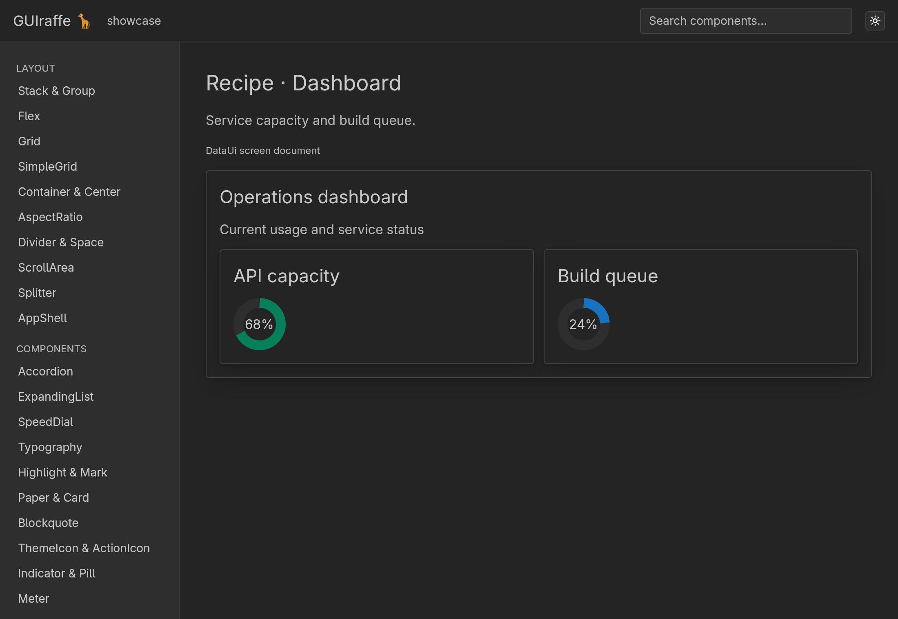
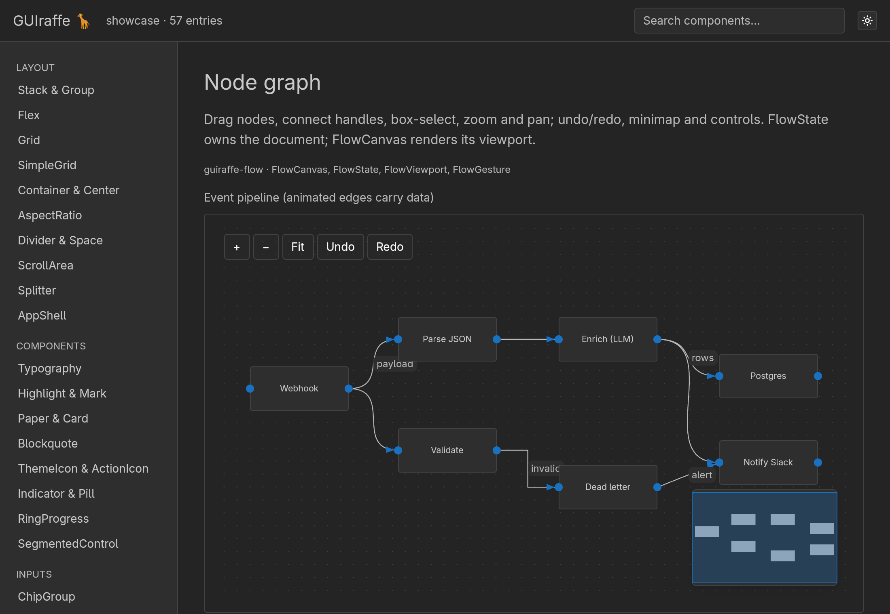
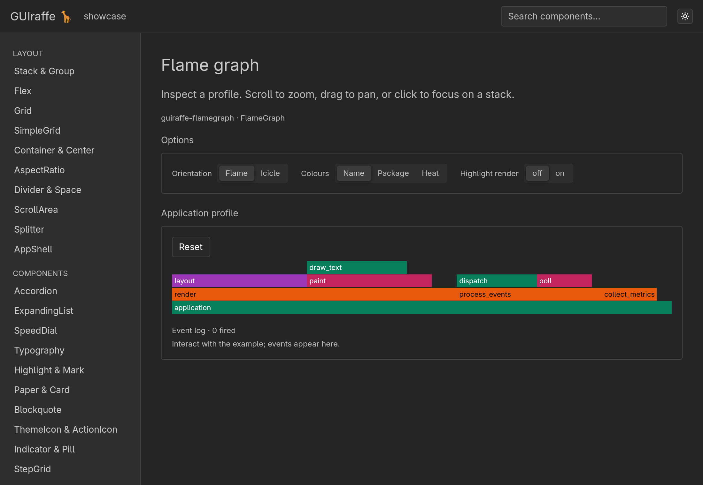

# GUIraffe 🦒

Rich, fast desktop applications in Rust: the components and conveniences you would reach for in
React, without shipping a browser.

<p>



</p>

> **Status: pre-1.0.** Developed and tested on Linux. macOS and Windows are untested, the crates
> aren't published, and APIs will change. See [known issues](KNOWN_ISSUES.md).

## What it is

GUIraffe is a framework and component library built on [GPUI](https://www.gpui.rs/), the GPU UI
framework from the Zed editor, and GPUI Kit. It adds:

- **Components:** layout, inputs, pickers, overlays, Spotlight, trees and property grids, data
  grid, spreadsheet, calendar, charts, flame graphs, Gantt and timeline editors, node graphs,
  code, Markdown, Mermaid and agent chat.
- **An app framework:** theming, typed routing, an event-driven store with undo, commands and
  keybindings, multiple windows, docking, motion, notifications and a system tray.
- **Three ways to write UI:** plain Rust builders, the [`ui!` macro](docs/guides/ui-macro.md), or
  [JSON documents](docs/guides/dataui.md) that tools and agents can write and validate.

The [architecture](docs/architecture.md) page explains how the pieces fit.

## Why use it

- **You need serious components.** The large ones are virtualized and built for big data: ten
  million grid rows, code lines, flame-graph frames or chart points.
- **You want native weight with web convenience.** It is one Rust process with no browser, no
  JavaScript runtime and no bridge between your UI and your logic.
- **You want one design language.** Containers set size, spacing and density, and widgets inherit
  them. Light, dark and high-contrast themes come from semantic tokens.
- **You want to pay for what changed.** Views notify narrowly, unchanged subtrees can be replayed
  from cache, and long work runs off the UI thread.

Choose something else if you need macOS, Windows or mobile today, stable APIs, published crates,
or verified screen-reader support.

## Why trust it

Check it, don't take our word for it:

- **Tested on two rendering backends.** About 1,700 tests run on upstream GPUI and again on GPUI
  Fast, including interaction, property, allocation and scaling tests.
- **Visually tested.** Screenshot goldens cover the showcase in light and dark.
- **Measured at scale, failures included.** [Performance](docs/performance.md) lists the budgets,
  what was measured, under which conditions, and what still misses.
- **Open about problems.** [Known issues](KNOWN_ISSUES.md) includes the budgets 0.2 doesn't meet.
- **Reproducible.** `scripts/gate.sh` runs the whole gate and `scripts/leak-check.py` runs the
  leak check. [Testing](docs/testing.md) explains both.

## How to use it

You need Rust 1.97 or newer and the [Linux packages](docs/getting-started.md#prerequisites).
You don't need to clone the repository.

Try the examples:

```sh
cargo install --locked --git https://github.com/hivemind-ai-core/guiraffe \
  --rev 716d957e4cdd3c950099800dcee5d4210508117e \
  --debug --features gpui-fast getting-started-examples --examples
00_quickstart
```

See every component, or the components working together as an app:

```sh
cargo install --locked --git https://github.com/hivemind-ai-core/guiraffe \
  --rev 716d957e4cdd3c950099800dcee5d4210508117e \
  --features gpui-fast guiraffe-showcase
guiraffe-showcase

cargo install --locked --git https://github.com/hivemind-ai-core/guiraffe \
  --rev 716d957e4cdd3c950099800dcee5d4210508117e \
  --features gpui-fast guiraffe-gallery
guiraffe-gallery
```

To build your own app, [copy the manifest and lockfile](docs/getting-started.md#create-your-own-app)
from the tutorial. They use git dependencies, so the app builds in any directory on any supported
machine. The first build downloads about 700 MB, mostly screenshot-test history.

| | |
|---|---|
| **Tutorial** | [Getting started](docs/getting-started.md): six small apps, from a window to pages with a store |
| **Guides** | [`ui!` and components](docs/guides/ui-macro.md) · [DataUi documents](docs/guides/dataui.md) · [Coming from React or Electron](docs/guides/from-react-electron.md) |
| **Reference** | [Crates, examples, commands and API docs](docs/reference.md) |
| **Project** | [Roadmap](ROADMAP.md) · [Changelog](CHANGELOG.md) · [Contributing](CONTRIBUTING.md) |

## License

[MIT](LICENSE). Vendored dependencies and the Lucide icons keep their own licenses.
